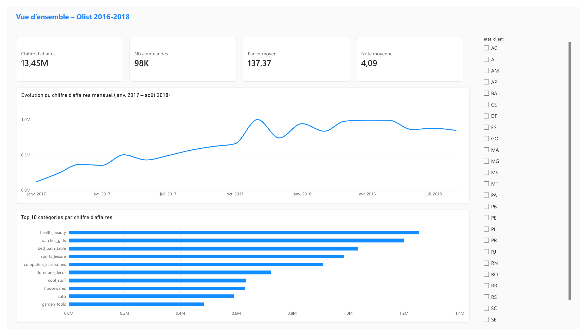
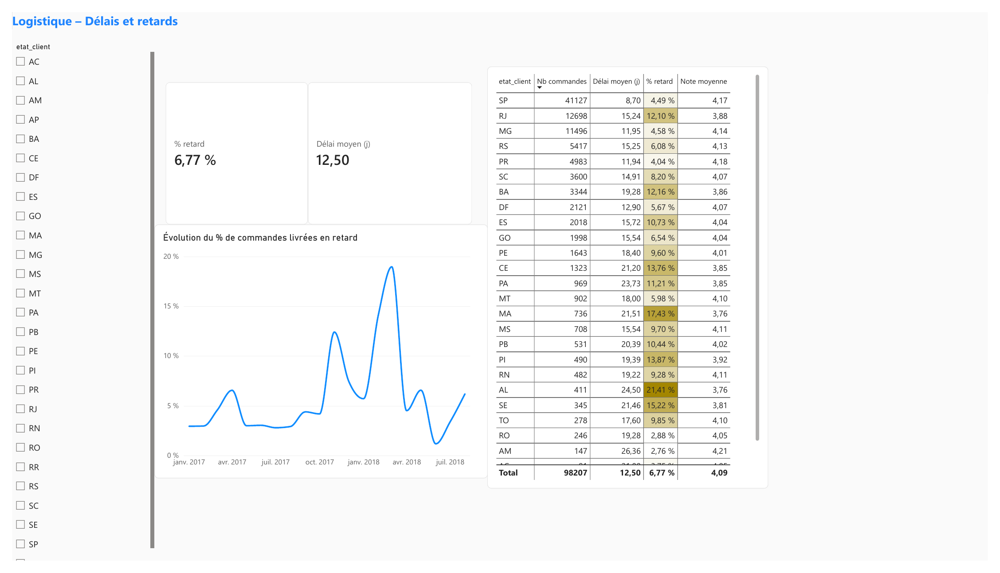
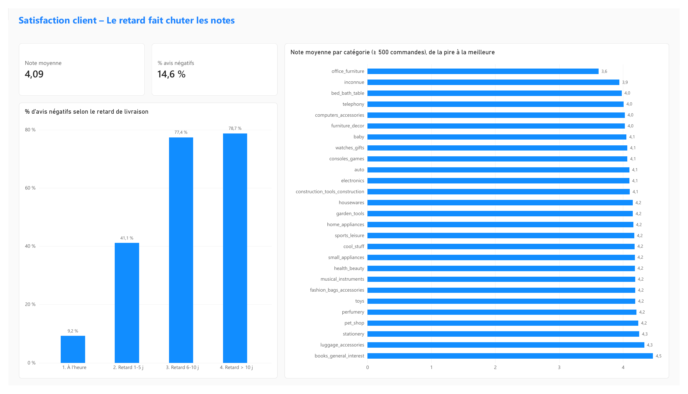
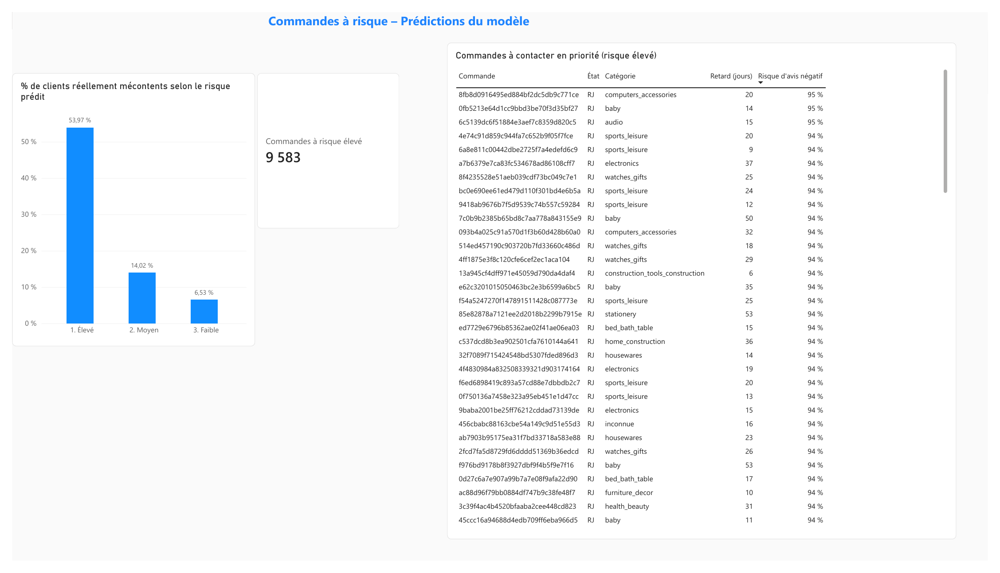

# Olist – Pourquoi les clients sont mécontents, et comment les repérer à temps

> Projet Data Analyst de bout en bout : **ETL Python → PostgreSQL → analyses SQL → statistiques → Machine Learning → dashboard Power BI**,
> sur ~100 000 commandes réelles d'une marketplace e-commerce brésilienne.

**Stack** : Python (pandas, scikit-learn, SciPy) · PostgreSQL · SQL · Power BI (DAX) · Jupyter · Git

---

## En bref

| | |
|---|---|
| **Question métier** | Qu'est-ce qui fait chuter les notes clients, et peut-on repérer à l'avance les commandes qui recevront un avis négatif ? |
| **Réponse** | Le **retard par rapport à la date de livraison promise** est de loin le facteur n°1. Le prix et les frais de port n'ont quasiment aucun effet. |
| **Chiffre clé** | **9 %** d'avis négatifs quand la commande arrive à l'heure, contre **41 %** pour 1 à 5 jours de retard et **79 %** au-delà de 10 jours. |
| **Modèle** | Une forêt aléatoire repère **10 % des commandes** qui concentrent **42 % des clients mécontents** (54 % d'avis négatifs dans ce groupe, contre 12,8 % en moyenne). |
| **Recommandation n°1** | Promettre des dates de livraison prudentes et contacter en priorité les clients livrés en retard, avant qu'ils ne laissent leur avis. |

---

## Le dashboard Power BI

4 pages, connectées à PostgreSQL : fichier [`powerbi/dashboard_olist_final.pbix`](powerbi/dashboard_olist_final.pbix), version PDF dans [`powerbi/dashboard_olist_final.pdf`](powerbi/dashboard_olist_final.pdf).

**1. Vue d'ensemble** : 13,45 M R$ de chiffre d'affaires, 98 000 commandes, panier moyen de 137 R$, note moyenne de 4,09 / 5.


**2. Logistique** : les retards se concentrent sur certaines périodes (Black Friday 2017, mars 2018) et certains États.


**3. Satisfaction** : la part d'avis négatifs explose dès que la date promise est dépassée.


**4. Commandes à risque** : les prédictions du modèle, et la liste des commandes à contacter en priorité.


---

## Démarche

| Étape | Ce que j'ai fait | Fichiers |
|---|---|---|
| **1. Modélisation** | Schéma relationnel des 9 tables : clés primaires et étrangères, index | [`sql/01_schema.sql`](sql/01_schema.sql) |
| **2. ETL et qualité** | Nettoyage, typage, dédoublonnage (≈ 260 000 lignes de géolocalisation en double ou hors du Brésil supprimées), contrôles de cohérence des dates, chargement transactionnel avec `COPY`, rapport qualité automatique | [`src/etl.py`](src/etl.py) |
| **3. Analyses SQL** | 6 analyses : ventes mensuelles, croissance (`LAG`), notes par catégorie, retards par État, fidélité, test retard → retour client (`ROW_NUMBER`, `PARTITION BY`) | [`sql/03_analyses.sql`](sql/03_analyses.sql) |
| **4. Statistiques** | Distribution des notes, effet de seuil du retard, tests du khi-deux, corrélations de Spearman | [`notebooks/01_statistiques.ipynb`](notebooks/01_statistiques.ipynb) |
| **5. Machine Learning** | Classification des avis négatifs : baseline, régression logistique, arbre, forêt aléatoire, validation croisée, `GridSearchCV`, importance par permutation | [`notebooks/02_machine_learning.ipynb`](notebooks/02_machine_learning.ipynb) |
| **6. Industrialisation** | Prédictions hors échantillon (`cross_val_predict`) écrites dans PostgreSQL pour Power BI | [`src/scoring.py`](src/scoring.py) |
| **7. Dashboard** | Vues SQL dédiées, mesures DAX, colonne calculée, 4 pages | [`sql/04_vues_powerbi.sql`](sql/04_vues_powerbi.sql), [`docs/powerbi_mesures.md`](docs/powerbi_mesures.md) |

---

## Résultats

### Ventes
- **Forte croissance en 2017**, puis plateau autour de 1 M R$ par mois en 2018.
- **Pic du Black Friday** (novembre 2017), suivi d'un retour à la normale en décembre (saisonnalité, pas une crise).
- Les mois de 2016 et de septembre-octobre 2018 sont **incomplets** et ont été exclus des tendances, pour ne pas faire croire à une chute des ventes.

### Le retard, cause n°1 de l'insatisfaction
- **6,8 %** des commandes livrées arrivent en retard, mais elles concentrent une grande partie des avis négatifs.
- Avis négatifs : **9,2 %** à l'heure, puis **41,1 %** pour 1-5 jours de retard, **77,4 %** pour 6-10 jours et **78,7 %** au-delà (khi-deux, p < 10⁻³⁰⁰).
- **Effet asymétrique** : livrer très en avance n'améliore la note que de +0,18 point, alors que le retard la fait chuter de plus de 2 points.
- Le prix et les frais de port n'ont **quasiment aucun lien** avec la note (corrélations de Spearman ≈ −0,03) : le client les connaît avant d'acheter.

### Où et quand
- **Périodes de crise** : environ 12 % de retards au Black Friday 2017 et **19 % en mars 2018**, contre 3 à 6 % le reste du temps.
- **Géographie** : les États éloignés des vendeurs (concentrés autour de São Paulo) sont les plus touchés, par exemple **AL (21 %)** et **MA (17 %)**. São Paulo n'a que 4,5 % de retards.
- **Priorité business : Rio de Janeiro (RJ)**, 2ᵉ marché avec 12 698 commandes et **12 % de retards**. AL est le pire en proportion, mais RJ pèse 30 fois plus de clients.

### Fidélité
- **97 %** des clients n'ont passé qu'**une seule commande**.
- Un retard à la 1ʳᵉ commande réduit encore la probabilité de revenir (3,07 % contre 2,52 %, p = 0,016). L'effet est significatif mais modeste : la faible fidélité a d'autres causes.

### Machine Learning

| Scénario | Moment de la prédiction | Modèle retenu | ROC-AUC | Rappel |
|---|---|---|---:|---:|
| A | juste après l'achat | Forêt aléatoire | 0,655 | 47 % |
| B | à la livraison, avant l'avis | Forêt aléatoire | **0,760** | 52 % |

- **Baseline** « toujours positif » : 87 % d'accuracy mais **0 % de rappel**. L'accuracy est trompeuse quand les classes sont déséquilibrées.
- **Pas de fuite de données** : le scénario A n'utilise que des informations connues au moment de l'achat.
- **Stable** : en validation croisée 5 plis, ROC-AUC = 0,759 ± 0,005.
- **Feature n°1 : le retard** (importance par permutation), ce qui confirme les statistiques.
- **En pratique** : les 10 % de commandes classées « risque élevé » ont **54 %** d'avis négatifs réels, contre 6,5 % pour le risque faible.

---

## Recommandations

1. **Ne pas raccourcir les délais affichés.** La plupart des commandes arrivent en avance, et l'avance rapporte peu. Il vaut mieux garder des dates prudentes, et les allonger pour les États éloignés.
2. **Anticiper les pics** (Black Friday, début d'année) : renforcer la capacité des transporteurs et ajuster les dates promises pendant ces périodes.
3. **Prévenir le client dès que la date promise est dépassée**, avec une nouvelle date : il vaut mieux informer avant que le client ne constate le retard.
4. **Déployer le modèle au service client** : contacter les 10 % de commandes à risque élevé à la livraison permet d'atteindre 42 % des futurs mécontents, avec 4 fois moins de contacts qu'au hasard.
5. **Cibler Rio de Janeiro en priorité** : c'est là que le volume et le taux de retard se combinent.
6. **Travailler la fidélité** (97 % d'acheteurs uniques) avec une relance après une première commande réussie.

## Limites et pistes d'amélioration
- **Corrélation ≠ causalité** : l'effet du retard est très net, mais seul un test A/B (par exemple, contacter ou non les clients à risque) mesurerait l'impact réel d'une action.
- **`mois_achat`** capte des crises logistiques passées : une validation temporelle (entraînement sur 2017, test sur 2018) serait plus rigoureuse.
- **Les commentaires écrits** des clients (en portugais) ne sont pas exploités : une analyse NLP permettrait de comprendre les avis négatifs **sans** retard (produit abîmé, non conforme…).
- Les données s'arrêtent en 2018 : les conclusions décrivent cette période.

---

## Lancer le projet

Prérequis : Python 3.12, PostgreSQL, Power BI Desktop (Windows) et les 9 CSV du [dataset Olist](https://www.kaggle.com/datasets/olistbr/brazilian-ecommerce) dans `data/raw/`.

```bash
python -m venv .venv
# Windows : .venv\Scripts\activate   |   macOS/Linux : source .venv/bin/activate
pip install -r requirements.txt
copy .env.example .env         # (cp sous macOS/Linux) puis renseigner le mot de passe PostgreSQL
python src/check_setup.py      # vérifie l'installation et crée la base olist
python src/etl.py              # charge les 9 tables dans PostgreSQL + rapport qualité
python src/scoring.py          # écrit les prédictions du modèle (table predictions)
```
Ensuite : exécuter `sql/04_vues_powerbi.sql` dans pgAdmin, puis ouvrir le fichier `.pbix` et cliquer sur **Actualiser**.

## Structure du dépôt
```
olist-satisfaction/
├── data/raw/                 # CSV Olist (non versionnés)
├── sql/
│   ├── 01_schema.sql         # schéma relationnel
│   ├── 02_premieres_requetes.sql
│   ├── 03_analyses.sql       # 6 analyses SQL commentées
│   └── 04_vues_powerbi.sql   # vues pour Power BI
├── src/
│   ├── config.py             # chemins et connexion
│   ├── check_setup.py        # vérification de l'environnement
│   ├── explore.py            # découverte des données
│   ├── etl.py                # ETL + contrôles qualité
│   └── scoring.py            # prédictions du modèle → PostgreSQL
├── notebooks/
│   ├── 01_statistiques.ipynb
│   └── 02_machine_learning.ipynb
├── powerbi/                  # dashboard (.pbix) et export PDF
├── docs/powerbi_mesures.md   # aide-mémoire connexion et mesures DAX
└── reports/figures/          # captures du dashboard
```

## Auteur
**Syphax Yahiaoui** — Data Analyst
